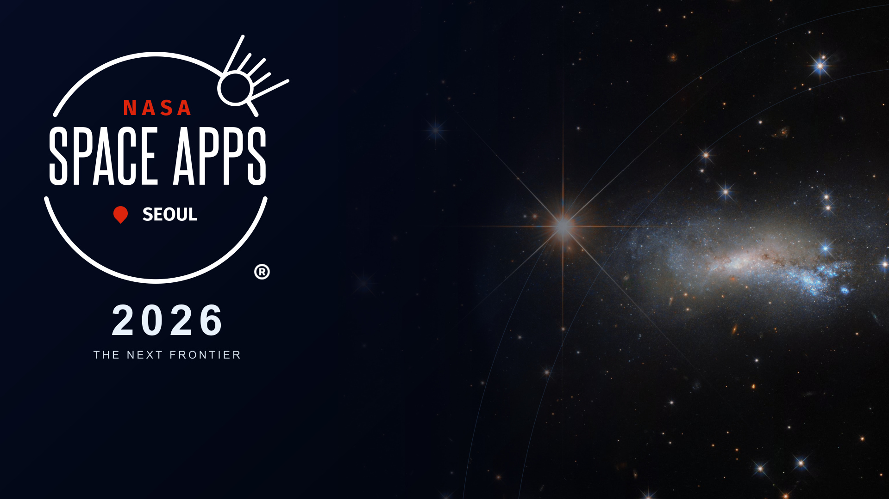
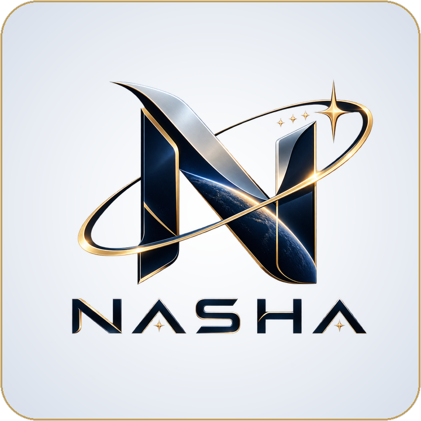

  

  

<h1 align="center">Mars-Beacon</h1>

  <b>Team NASHA</b> · NASA Space Apps Challenge 2026 · Seoul

---

## Team

**NASHA**

## Selected challenge

**Interplanetary Survival Guide: Martian Map**

## Project

**Mars-Beacon**, our project for the Martian Map challenge. Details, setup steps and the demo link will be added here as the build progresses.

## License

This project is licensed under the [Apache License 2.0](LICENSE).

---

The banner above is the NASA Space Apps Seoul 2026 event image provided by the local organizers and is shown only to identify the event. It is not this project's branding, and NASA has not endorsed or approved this project.
