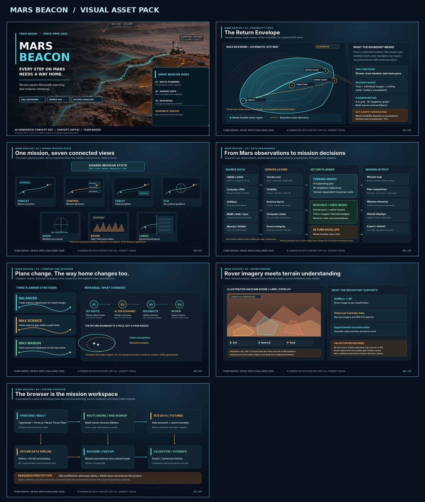

# Mars BEACON

**Every step on Mars needs a way home.**

**[Open the live project](https://mars-beacon.pages.dev/) · [Launch the mission map](https://mars-beacon.pages.dev/#/app) · [Source code](https://github.com/Harishik/Mars-Beacon)**

Team **NASHA** · NASA Space Apps Challenge 2026 · Seoul  
Challenge: [Interplanetary Survival Guide: Martian Map](https://www.spaceappschallenge.org/2026/challenges/interplanetary-survival-guide-martian-map/)

Mars BEACON is a browser-based Marswalk planning and rehearsal prototype. It brings real orbital terrain, rover imagery, environmental context, and a two-person mission model into one interactive map. Its **Return Envelope** asks: from this point, can both astronauts return to an active haven within their remaining resources and the selected reserve?

The primary site is a **3 × 3 km area of Mount Sharp's boxwork in Gale crater**. The science scenario compares a ridge with the hollow beside it. A second bundle demonstrates the site pipeline at Jezero crater.

> This is a hackathon research prototype, not an operational astronaut-safety system. “Certified,” “GO,” and “returnable” in the interface mean checks against the implemented model and chosen assumptions, not NASA approval or independently validated human safety. NASA does not endorse this project.

## Try it

1. Open the [mission map](https://mars-beacon.pages.dev/#/app) in a desktop browser with WebGL support. Allow the terrain bundle to load.
2. Read the site and its source layers, then select stops and compare **Balanced**, **Max science**, and **Max margin** plans.
3. Change suit load, pace, time, or the support-rover haven. Inspect how the return boundary and resource margins respond.
4. Rehearse the walk and switch between **Habitat, Control, Tablet, EVA, Visor, Rover, and Linked** displays.
5. Inspect the route home, source/assumption labels, and limitations. Export routes or use mission sharing when the backend is available.

The landing page is an interactive introduction, not the competition's short Project Demo. **Demo video and walkthrough video are intentionally pending.** Their reserved folders contain only empty Git placeholders: `demo-video/` and `walkthrough-video/`.

## Visual gallery (watermarked concept graphics)



The gallery contains seven **illustrative** 1920 × 1080 visuals created for Team NASHA. They explain the prototype, but are **not screenshots of the deployed interface, NASA imagery, measured mission results or operational safety evidence**. Numbers and routes depicted in the hero image are illustrative. Each exported visual carries a visible AI-generation watermark.

| Visual | Open | Editable source |
|---|---|---|
| 01 · Mars BEACON concept hero | [Watermarked image](assets/visuals/01_mars_beacon_hero.jpg) | Raster concept |
| 02 · Return Envelope | [PNG](assets/visuals/PNG_1920x1080/02_return_envelope.png) | [SVG](assets/visuals/SVG_Editable/02_return_envelope.svg) |
| 03 · Seven shared mission views | [PNG](assets/visuals/PNG_1920x1080/03_seven_views.png) | [SVG](assets/visuals/SVG_Editable/03_seven_views.svg) |
| 04 · NASA/USGS data pipeline | [PNG](assets/visuals/PNG_1920x1080/04_data_pipeline.png) | [SVG](assets/visuals/SVG_Editable/04_data_pipeline.svg) |
| 05 · Route comparison and rehearsal | [PNG](assets/visuals/PNG_1920x1080/05_route_comparison_rehearsal.png) | [SVG](assets/visuals/SVG_Editable/05_route_comparison_rehearsal.svg) |
| 06 · Rover intelligence | [PNG](assets/visuals/PNG_1920x1080/06_rover_intelligence.png) | [SVG](assets/visuals/SVG_Editable/06_rover_intelligence.svg) |
| 07 · System architecture | [PNG](assets/visuals/PNG_1920x1080/07_system_architecture.png) | [SVG](assets/visuals/SVG_Editable/07_system_architecture.svg) |

**Image credit:** ChatGPT (GPT-6), Team NASHA. **Development assistance:** OpenAI Codex and Anthropic Claude Code, as recorded separately in [AI_USAGE.md](AI_USAGE.md). The existing Microsoft TRELLIS.2 disclosure applies to the project's separate 3D concept-model collection, not to these new diagrams. See [visual attribution and limitations](assets/visuals/AI_ATTRIBUTION_AND_USAGE.md) and the [gallery manifest](assets/visuals/visual_manifest.json). Neither the short demo video nor the walkthrough video has been added.

## What is implemented

| Capability | Implementation and scope |
|---|---|
| Terrain-aware return planning | Browser Web Worker; multi-haven reverse Dijkstra on a 16-neighbour grid; paired crew move at the slower pace. Resources are evaluated along the same selected return path. |
| Consumables and reserve | Time, each suit's oxygen, and configured cooling-water/battery budgets; default 25% reserve parameter. These are model assumptions, not certified suit performance. |
| Data-driven site | USGS/NASA HiRISE DEM and orthophoto, a 4 m planning grid, Curiosity traverse and approximate science stops; regional context from Mars Trek. |
| Rehearsal and displays | Shared mission state drives habitat, mission-control, field, visor, rover, and linked views. |
| Environmental context | Mars24 time/sun calculations, dust climatology, REMS pressure/weather, historical RAD context, and DONKI integration with availability/age labels. |
| Derived terrain layers | Slope, roughness, horizon/sky-view, ridge/hollow, boulder candidates, science-value and radio line-of-sight layers. |
| Rover detail | Navcam images, M1 segmentation outputs, stereo patch and an experimental Altadena Gaussian-splat reconstruction. |
| Output and sharing | Route GeoJSON, waypoint tables and mission/debrief sharing support; server saves require the backend. |

See [project details](docs/PROJECT_DETAILS.md), [architecture](docs/ARCHITECTURE.md), and [validation and limitations](docs/VALIDATION_AND_LIMITATIONS.md).

## NASA and space-agency data

| Data | How Mars BEACON uses it |
|---|---|
| MRO HiRISE / USGS Gale DEM (1 m) and orthophoto (25 cm) | Terrain rendering, 4 m route calculations, slope/roughness and image context. Source sampling is distinct from effective accuracy. |
| Mars 2020 TRN HiRISE products | A second site bundle at Jezero, processed through the same site pipeline. |
| Curiosity waypoints, Navcam and PDS XYZ products | Historical traverse, approximate stops, rover views and local reconstruction. |
| AI4Mars | Training/evaluation data for the M1 rover-image terrain classifier. |
| Curiosity REMS and dust-opacity records | Rover-local weather/pressure and seasonal dust context; observations can be old and do not establish a local forecast. |
| Curiosity RAD | Historical radiation-rate context, not a terrain-resolved personal dose or shelter-shielding model. |
| NASA DONKI / WSA-ENLIL | Space-weather event context, including modelled Mars-directed CME arrivals where available. |
| JPL Mars Trek: MOLA, CTX, Viking | Regional terrain and imagery context. |

Exact products, attribution, transformations and unresolved source checks are in [Data Sources](docs/DATA_SOURCES.md), the [manifest layer register](docs/DATA_SOURCE_REGISTER.csv), and [References](REFERENCES.md).

## Run locally

Use Git and **Node.js 22.12+** (or another version satisfying the Vite lockfile). Python is only needed for the backend or offline processing.

```bash
git clone https://github.com/Harishik/Mars-Beacon.git
cd Mars-Beacon/frontend
npm ci
npm run dev
```

Open `http://localhost:5173/` or `http://localhost:5173/#/app`. Vite serves the committed `fixtures/` directory, including real site bundles, at the web root. The default site is `gale-boxwork`; synthetic data is separately named `gale-synthetic`.

```bash
# From frontend/
npm run typecheck
npm test
npm run build
npm run preview
```

For local API setup, Git LFS models, deployment and the optional data pipeline, see [Setup](docs/SETUP.md). The static planning engine does not require a database. Saving missions and server feed caches do.

| Frontend variable | Purpose |
|---|---|
| `VITE_BUNDLE_BASE_URL` | Parent URL containing `<siteId>/manifest.json`; defaults to `./bundle`. |
| `VITE_SITE_ID` | Default site; defaults to `gale-boxwork`. |
| `VITE_BEACON_API` | Backend URL; use `/api` with the local Vite proxy. The code defaults to the team's Azure API. |

All `VITE_*` values are public build-time configuration. Keep private NASA/API/database credentials on the backend, never in frontend configuration. Copy [frontend/.env.example](frontend/.env.example) for local overrides.

## Repository map

| Path | Contents |
|---|---|
| `frontend/` | React, TypeScript, Three.js/React Three Fiber, Zustand, Web Worker engine and Vitest tests. |
| `backend/` | FastAPI, local SQLite / production PostgreSQL, mission persistence and cached feeds. |
| `pipeline/` | Offline Python site generation, terrain models, simulation checks and reconstruction. |
| `contracts/` | API, mission state and site-manifest formats. |
| `fixtures/` | Published site bundles, synthetic development data, regional imagery and 3D concept assets. |
| `models/` | M1 model card, metrics, calibration and Git LFS weights. |
| `docs/` | Current setup, architecture, source and validation documentation; historical plans and research notes remain in their subfolders. |
| `assets/` | Existing team/event artwork and [asset credits](assets/ASSET_CREDITS.csv). |
| `submission/` | Form-ready text and the remaining submission checklist. |
| `demo-video/`, `walkthrough-video/` | Reserved, no video content added. |

## Use of AI / Attribution

The team used **Anthropic Claude Code** and **OpenAI Codex** as coding assistants, and **Microsoft TRELLIS.2** to generate 3D model assets. Codex also assisted this README and supporting submission documentation. AI assistance applies to project development across the frontend, backend, offline pipeline and documentation; this is a project-level disclosure, not a claim that every file was AI-generated or a verified per-tool authorship map.

The generated 3D concept assets are distinct from NASA observational terrain and rover imagery. Their attribution scope is recorded in [AI_USAGE.md](AI_USAGE.md) and [asset credits](assets/ASSET_CREDITS.csv). Before publishing screenshots or video containing generated assets, add a visible generation label; keep it visible throughout generated video portions. A README acknowledgement alone does not replace the guide's visible-media labelling rule.

## Evidence and limits

The M1 model card reports calibrated **mIoU 0.806 on 322 expert-labelled test images at min3 agreement**, with big-rock IoU **0.347**. This is a repository-reported segmentation result, not end-to-end navigation validation. M2 boulder precision/recall and M3 ridge/hollow annotation checks remain incomplete; Jezero boulder detections are unreliable. The rover reconstruction did not meet its novel-drive quality gate.

Feeds may fail or be rate-limited; the newest published REMS observation may lag the current date. P90 terrain sensitivity is based on assumed DEM perturbations, not a 90% probability of safe return. Read [Validation and Limitations](docs/VALIDATION_AND_LIMITATIONS.md) before interpreting results.

## Team and licence

| Team member | GitHub | Project contribution areas |
|---|---|---|
| Harishik | [@Harishik](https://github.com/Harishik) | Frontend, interaction/planning integration, terrain reconstruction and project integration. |
| Sahaj | [@sahaj2310-tech](https://github.com/sahaj2310-tech) | Scientific data processing, site bundles, terrain/ML models and simulation calibration. |
| Naomi | [@naomesk](https://github.com/naomesk) | Backend/API, database and deployment integration. |

See [full team credits](CONTRIBUTORS.md) and the [contributing guide](CONTRIBUTING.md). Team contributions are recognized independently of GitHub's automatic commit-based Contributors list.

Original project code is under [Apache License 2.0](LICENSE). Data, dependencies, third-party artwork and generated-asset inputs retain their own terms. See [References](REFERENCES.md), [dependency inventory](docs/DEPENDENCIES.csv), and [AI disclosure](AI_USAGE.md). NASA data use does not imply NASA endorsement.
