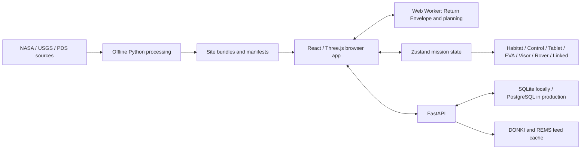

# Architecture

## Runtime

The public frontend is deployed at https://mars-beacon.pages.dev/. `frontend/src/data/api.ts` defaults to the team's Azure API; `VITE_BEACON_API` overrides it. Historical notes that describe Cloud Run or automatic deployment on every merge are design history, not proof of the current infrastructure.

## Site data

`frontend/src/data/bundle.ts` loads `<base>/<siteId>/manifest.json` and typed raster files. A manifest records grid dimensions, coordinate axes, scales, nodata values, source attribution and product IDs. The Gale grid is 750 × 750 cells at 4 m, covering 3 × 3 km. Raster row zero is north; site x is east and y is north. Source DEM/imagery sampling and the routing grid have different resolutions.

Vite's `publicDir` points to `../fixtures`. Despite its historical name, this folder now includes real processed Gale/Jezero bundles as well as explicitly synthetic development data.

## Return model

`frontend/src/engine/envelope.ts` runs reverse Dijkstra from active havens over 16-neighbour terrain edges. The pair uses the slower member's pace. Oxygen for both crew members is accumulated along the same time-selected tree path; configured water and battery budgets are checked as well. A reserve factor is applied to the estimated return requirements. This is not an exhaustive search over all resource-optimal paths: a time-optimal path can differ from an oxygen-optimal one.

The engine excludes non-finite terrain and slopes above the selected limit, checking crossed cells for corner cutting. P90 calculations reuse assumed perturbed-terrain slopes. They are sensitivity analysis, not a calibrated probability of survival.

`query.ts` reports the route home, return cost, limiting resource and allowable stop time. `planner.ts` compares stop sequences. `store/store.ts` holds the shared mission state. Mars time/sun, environmental context and thermal estimates are separate modules.

## Backend and failure behavior

FastAPI supplies site/provenance endpoints, mission saving/loading and cached environmental feeds. SQLite supports local use; PostgreSQL supports deployment. The current backend does not require PostGIS for ordinary local operation. Endpoint details and environment variables are in [backend/README.md](../backend/README.md).

The already-loaded bundle and browser engine can continue when the API is unavailable. New downloads and uncached assets still need network access; this is not a claim of a fully offline installable app. Mission saving/loading and fresh feeds depend on services. LIVE/STALE/UNAVAILABLE badges and timestamps must be read alongside values.

## Visual assets

Real terrain/imagery, reconstructed rover detail, procedural geometry and AI-generated concept models have different provenance. Spark supports experimental splat rendering. Shared display state does not make a rendered surface an independent measurement. See [AI_USAGE.md](../AI_USAGE.md) and [Data Sources](DATA_SOURCES.md).
